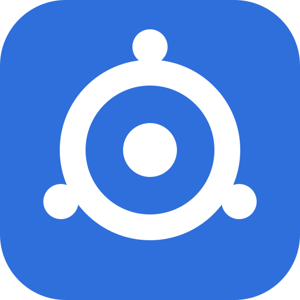

# Outpost

**Turn the computers on your home network into one local AI cluster.**

Outpost is a self-hosted system for fanning programming tasks out across your own machines. You
describe a task in a web page. A planner (Claude, OpenRouter, or a local model on one of your
machines) splits it into small subtasks. You approve the plan, your machines write the pieces in
parallel with local models (llama.cpp), and Outpost reviews the result, runs the tests, fixes
failures and hands you a zip. It also does general chat, with an OpenAI-compatible API.

It is a single self-contained binary with two modes, and no other software to install:

- **Controller**: the web UI, planning, job dispatch, and storage for models and releases. One per cluster.
- **Node**: runs llama.cpp and commands for the controller. Keeps no job data after a job. As many as you like.


*New task: describe what you want, or start from a sample project.*


*A task in progress: the approved plan, and subtasks being written in parallel on different nodes.*

## Quick start

1. **Install the controller** on one always-on machine ([commands below](#install)).
2. **Open its web UI** (`https://<controller>:8443`), accept the self-signed certificate warning and choose an admin password.
3. **Add each other machine as a node**: on the **Nodes** page click **Add node** and paste the single command it shows.
4. **Load a model** on a node (the UI recommends one that fits each machine) and, if you want, add a Claude or OpenRouter key under Settings.
5. **Describe a task**, answer any questions, approve the plan, and download the result.

## Key features

- **Parallel task execution.** A plan is split into subtasks that run on different nodes at once, with peer review, test runs on an exec-enabled node, and automatic fix rounds.
- **Agent mode** for investigating and fixing existing code, plus projects with git, attachments and project instructions.
- **Smart routing.** The biggest, fastest loaded model gets the hardest work; benchmarks, best-of-N on spare nodes, and optional memory pooling across machines (experimental, off by default).
- **Model management.** Browse and download models from Hugging Face, with per-node fit estimates, context-size sizing and automatic disk clean-up.
- **Chat and an OpenAI-compatible `/v1` API** so editors and agents (aider, Open WebUI and others) can use your cluster.
- **Hands-off operation.** Saved and scheduled tasks, working hours, Wake-on-LAN, notifications, a spending cap for cloud planners, and tasks that resume after a controller restart.
- **Safe to run.** Lockout and API tokens, encrypted backups, Linux command sandbox, and in-UI updates with rollback. See [SECURITY.md](SECURITY.md).

## Install

Download the binary for each machine's platform from the [releases page](https://github.com/64fedoras/outpost/releases):
`outpost-linux-amd64`, `outpost-linux-arm64`, `outpost-darwin-amd64`, `outpost-darwin-arm64`
or `outpost-windows-amd64.exe`. Release binaries are unsigned; see [docs/BUILDING.md](docs/BUILDING.md) to verify checksums or build from source.

### Controller (Linux, systemd)

```bash
sudo chmod +x ~/outpost-linux-amd64 && sudo ~/outpost-linux-amd64 install controller --advertise https://192.0.2.10:8443
```

Replace the address with the one your nodes will use to reach the controller. The first install sets
no password: open the web UI straight away and choose one on the "Set up Outpost" screen. Whoever
opens it first sets the password, and by default only LAN addresses are accepted for this step.

### Nodes

On the **Nodes** page click **Add node**, then paste the command it gives you on the node. It looks like this:

| Platform | Command |
| --- | --- |
| Linux | `sudo chmod +x ~/outpost-linux-amd64 && sudo ~/outpost-linux-amd64 install node --join <token>` |
| Windows (Administrator PowerShell) | `.\outpost-windows-amd64.exe install node --join <token>` |
| macOS (no sudo) | `chmod +x ./outpost-darwin-arm64 && ./outpost-darwin-arm64 install node --join <token>` |

- **Linux** installs a systemd service that starts at boot. GPU nodes use llama.cpp's Vulkan build and need the system Vulkan driver (`sudo apt install libvulkan1 mesa-vulkan-drivers`).
- **Windows** installs the **Outpost Node** service and adds a Microsoft Defender exclusion for `C:\ProgramData\outpost`.
- **macOS** installs a per-user LaunchAgent so llama.cpp can use the GPU through Metal.

Everything else (llama.cpp builds, models, the Go toolchain for test runs) is fetched by the
controller and copied to nodes. More detail, options, the tray icon and troubleshooting are in the
[user guide](docs/USER-GUIDE.md#install-starts-at-boot).

## Platform status

Outpost is developed and tested on Linux. **Treat everything else as untested until you have tried it:**

- **Windows** (service install, tray icon, self-update, Defender exclusion, PowerShell test runs, GPU use from a service) has been built and unit-tested but never run on a real Windows machine.
- **macOS** (LaunchAgent, menu bar item) has never run on a real Mac.
- The current release has been tested against stub Claude and OpenRouter servers and a fake llama-server, **not on the real cluster** with real GPUs and transfer speeds. The live OpenRouter API was never called.

The full list of known limits is in the [user guide](docs/USER-GUIDE.md#known-limits).

## Documentation

| Read this | For |
| --- | --- |
| [User guide](docs/USER-GUIDE.md) | Everything: first run, tasks, nodes working together, updating, backups, settings, known limits |
| [SECURITY.md](SECURITY.md) | Threat model, protections, limits, reporting a problem |
| [docs/BUILDING.md](docs/BUILDING.md) | Verifying downloads, building from source |
| [docs/ARCHITECTURE.md](docs/ARCHITECTURE.md) | Data folders, node connection, task lifecycle, update flow |
| [docs/ROADMAP.md](docs/ROADMAP.md) | What was built and what is untested |
| [testing/README.md](testing/README.md) | The local test rig |

## License

Outpost is free software under the GNU Affero General Public License v3.0 only (`AGPL-3.0-only`);
see [LICENSE](LICENSE). Copyright (C) 2026 Mark (64fedoras). The web UI links to the source of the
running version and to `/licenses`. Third-party licences, including the `libgomp` library bundled
in Linux x86-64 builds, are in [THIRD_PARTY_NOTICES.txt](THIRD_PARTY_NOTICES.txt) and in the
[user guide](docs/USER-GUIDE.md#third-party-code-inside-the-binary). This is not legal advice.
