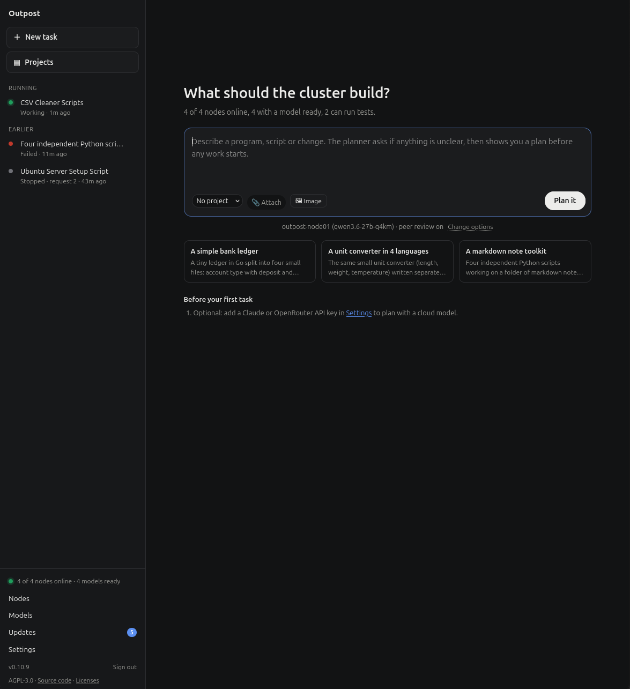
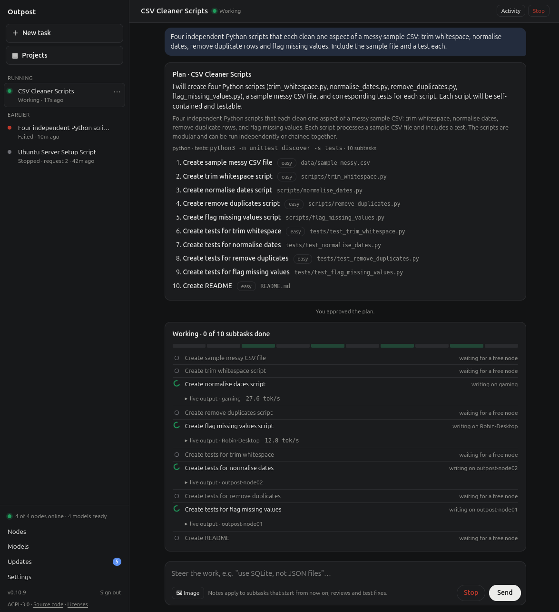

# Outpost

Self-hosted AI cluster. One binary runs as the **controller** (web UI, planning, job dispatch) or as a
**node** (runs local models with llama.cpp, runs commands, keeps nothing after a job).

You describe a programming task; a planner (Claude, or a local model on one of your nodes) splits it
into small subtasks; you approve the plan; your nodes write the pieces in parallel; Outpost runs the
tests, fixes failures, and gives you a zip to download.

## Screenshots



*New task: describe what you want, or start from a sample project.*



*A task in progress: the approved plan, and subtasks being written in parallel on different nodes.*

## At a glance

1. Install the controller on one machine and open its web UI ([Install](#install-starts-at-boot)).
2. Add each other machine as a node with the single-paste command from the UI's **Add node** dialog.
3. Describe a task, answer any questions, approve the plan, then download the result.

**Contents:** [Install](#install-starts-at-boot) · [First run](#first-run) · [Working with tasks](#working-with-tasks) ·
[Nodes working together](#nodes-working-together) · [Updating](#updating) ·
[Sign-in security and backups](#sign-in-security-api-tokens-certificate-and-backups) · [Security policy](SECURITY.md) · [Known limits](#known-limits) ·
[License](#license) · [Building and verifying](#building-and-verifying)

**More documentation:** [SECURITY.md](SECURITY.md) (threat model, protections, known limits, reporting) ·
[docs/BUILDING.md](docs/BUILDING.md) (verify downloads, build from source) ·
[docs/ARCHITECTURE.md](docs/ARCHITECTURE.md) (data folders, connection, task lifecycle) ·
[docs/ROADMAP.md](docs/ROADMAP.md) (what was built and what is untested) · [testing/README.md](testing/README.md)

## Install (starts at boot)

Linux with systemd. Copy the binary to each machine, then install it as a service. Re-running an
install is safe: it updates the service and keeps existing data and passwords.

### Controller

```bash
scp outpost-linux-amd64 admin@controller.example.local:~/
ssh -t admin@controller.example.local 'sudo chmod +x ~/outpost-linux-amd64 && sudo ~/outpost-linux-amd64 install controller --advertise https://192.0.2.10:8443'
```

A first install sets **no password** and prints or logs none. Open the web UI right away, accept the
self-signed certificate warning and choose your admin password on the "Set up Outpost" screen (8+
characters); you are signed in and that screen never appears again. Whoever opens it first sets the
password, so do it straight after installing. By default only private/LAN addresses (and loopback) are
accepted for this step; to allow others add `--setup-allow-from 203.0.113.0/24,10.0.0.5` (or `any`) to
`install controller` / `controller`. Setup is rate limited and only works while no password exists.

### Nodes

Put `outpost-linux-amd64` in the node's home folder (any way you like), then on the **Nodes** tab
click **Add node** and paste the one command it gives you. If you type the node's SSH target (for
example `admin@node1.example.local`) it wraps the command in `ssh -t` so you can run it from your own
computer:

```bash
ssh -t admin@node1.example.local 'sudo chmod +x ~/outpost-linux-amd64 && sudo ~/outpost-linux-amd64 install node --join <token>'
```

The node service runs as the user who ran `sudo`, keeps its data in `~/.outpost/node`, and runs jobs
as that user. A machine that already joined becomes a service with `sudo outpost install node`.

Nodes need nothing else installed. The controller fetches llama.cpp and models once and copies
them to nodes, and the Outpost binary carries the small system library llama.cpp needs that minimal
Linux installs lack (`libgomp`), dropping it next to llama.cpp only when the machine is missing it.
The one exception is GPU drivers: GPU nodes use llama.cpp's Vulkan build, which needs the system's
Vulkan driver (`sudo apt install libvulkan1 mesa-vulkan-drivers`). The node card tells you if it is
missing.

**Freeing disk space automatically:** when a node is about to receive a model (copied from the controller or downloaded from Hugging Face) and its disk is too small, it deletes stored models to make room instead of failing. It removes models the controller also holds a copy of first, then, only if that is not enough, models it downloaded straight from Hugging Face (they download again when needed); within each group the least recently used goes first (last load or arrival), and it stops as soon as the new model fits with some headroom (the larger of 1 GB and 5%). It never touches the loaded model, the one it reloads after a restart, or one being copied or downloaded, and models the controller does not know are left alone. If deleting everything eligible would still not make room, nothing is deleted and the error says so (`not enough disk space: need 16.9 GB, have 15.4 GB; ... nothing was deleted`). Each cleanup is written to the node log and shown on the node card for a day ("Freed 12.0 GB by removing X"). Turn it off under Settings -> Free disk space. The "need" figure subtracts what a partly downloaded model already has on disk. **Untested** on real nodes, Windows and macOS: covered by unit tests with a simulated disk.

**Cleaning up old models:** a node's card lists the models stored on its disk, each with a **×** to delete just that one (after a confirmation; models in use have no ×, and the node refuses them anyway). **clean up…** opens a
list with sizes, everything ticked except the model that is loaded; the button shows how much space
the deletion frees. The node itself always keeps the model that is loaded, the one it reloads after a
restart (autoload), and any model being copied or downloaded right now, whatever the request says.
*Also delete interrupted downloads* removes model folders that never finished (no manifest). Only
folders directly inside the node's `models/` folder are deleted, and symlinks are skipped. Copies on
the controller and on other nodes are untouched, so a node that needs a model again fetches it again.
The **×** next to a model still deletes just that one.

**Windows:** open an **Administrator** PowerShell (right-click Start, *Terminal (Admin)*), go to the
folder with the exe and run the command from **Add node**:

```powershell
.\outpost-windows-amd64.exe install node --join <token>
```

This installs the **Outpost Node** Windows service: it runs as LocalSystem, starts at boot with no
one signed in, restarts if it stops, and updates and rollbacks from the web UI restart it by
themselves. From a normal (non-admin) PowerShell the install stops before using the join code and
says how to open an admin one, so the same code still works. The installer also adds the Microsoft
Defender exclusion for `C:\ProgramData\outpost` (and prints how to undo it; skip with
`--no-defender-exclusion`). The tray icon starts when you sign in and talks to the service;
**Quit Outpost** there stops the service (it stays stopped until the next boot), and while it is
stopped the tray shows **Start Outpost**, which starts it again without an admin prompt (the
installer lets signed-in users start and stop this one service). Remove it with
`outpost.exe uninstall node` (admin; data and models are kept).

`--no-service` installs the old per-user mode instead: a background process with a tray icon that
runs only while you are signed in. Run the install again from an admin PowerShell (without
`--no-service`) to switch an existing per-user node to the service; its `node.json` is kept, so no
join code is needed. Either way the exe lives in `C:\ProgramData\outpost\outpost.exe` and logs go
to `C:\ProgramData\outpost\node\node.log`.

**Windows Firewall prompts.** Each update runs a new exe (`node\agent\outpost-<version>.exe`), so a
firewall rule tied to one exe path stopped matching and Windows asked "allow this app on public and
private networks" after every update. The installer, when run as administrator, now adds one rule by
port instead: **Outpost model sharing**, inbound TCP 8444, private and domain networks only, local
subnet only, for every Outpost version. A service node also converts a rule from an older install by
itself at start. A per-user install from a non-admin shell cannot add the rule, so the prompts
continue there; run the install command once in an admin PowerShell to stop them. If Windows has the
network marked **Public**, set it to **Private** (Settings, Network, the connection's properties):
the rule deliberately does not apply on public networks. Pool helper ports (pooling, off by default)
still get no rule. *Untested on real Windows.*

*Untested on real Windows:* the service, and whether llama.cpp's Vulkan backend can use the GPU
when run by a service (session 0). If a GPU node shows no GPU after switching, reinstall with
`--no-service`.

**macOS:** run `chmod +x ./outpost-darwin-arm64 && ./outpost-darwin-arm64 install node --join <token>`
(without sudo). This writes a per-user LaunchAgent (`~/Library/LaunchAgents/io.outpost.node.plist`) so the
node starts when you log in and restarts if it stops, with the binary in `~/.outpost/outpost` and logs in
`~/.outpost/node/node.log`. It is per-user, not a system daemon, so llama.cpp can use the GPU through Metal.
`outpost uninstall node` removes it. A menu bar item (see *Tray icon* below) is installed with it and starts at login.
*Untested on a real Mac.* Running `outpost node --join <token>` in a terminal still works.

### Tray icon (desktop machines)

Desktop nodes get a tent icon in the system tray (notification area): **green** while taking work,
**amber** while paused, **gray** while disconnected or stopped. Its menu:

- Status, the controller it is joined to, and the loaded model.
- **Work mode**, one of three (the ticked one is the current state):
  - **Accept new work:** the controller can send tasks and jobs here.
  - **Finish current work, then pause:** no new work; jobs already running here finish first. The
    status line says *finishing N job(s)* until they are done, then the node is paused.
  - **Pause now (cancels running work):** stops running jobs at once. A subtask that was being
    written goes back in the queue for another node, and a test run starts again on another exec
    node (up to twice). Other steps running there (review, fix, agent or build runs) fail as they
    would if the node went offline. While paused with nothing running, this item is the ticked one.

  Paused is amber, and the node card in the web UI says *Paused on the node*. Pausing survives
  restarts. Pausing does **not** unload the model, and pools keep lending.
- **Unload model:** frees the model's memory (RAM and VRAM) now, the same way an idle unload does.
  The node keeps taking work and loads the model again when the next task needs it (pause
  it as well if nothing should load it). Greyed out while a job is running, while
  the model is still loading, and for a pooled model (unload that from the web UI). After a node
  restart the model loads again as usual.
- **Open controller web UI.**
- **Join a different controller…:** opens a small local page where you paste a join code from
  the other controller's **Add node** dialog. Models stay on disk; the old settings are kept as
  `node.json.prev`.
- **Quit Outpost:** stops the node and closes the icon. On Linux the service stays stopped until
  **Start Outpost** in the tray (asks for your password), `sudo systemctl start outpost-node`, or
  the next boot.
- **Close this icon only:** the node keeps running.

On Linux, `install node` adds the icon to your desktop login when the machine has a desktop. It is
started right away if you are logged in to the desktop, and at every login after that. GNOME needs the
AppIndicator extension (Ubuntu Desktop includes it; on other GNOME setups install
`gnome-shell-extension-appindicator` and enable it). If no icon shows, read `tray.log` in the node's
data folder: it says when nothing on the desktop is listening for tray icons. Linux servers without a
desktop get no icon. Untested on a real desktop.

On macOS the same menu appears in the menu bar. `install node` adds a second per-user LaunchAgent
(`io.outpost.tray`, logs in `tray.log` in the data folder) that starts it at login; run `outpost tray &`
from Terminal to start it by hand. There is no cgo in Outpost's builds, so the item is drawn by a small
script run through `/usr/bin/osascript` (AppKit via the JavaScript-for-Automation bridge) that the
binary embeds. **Start Outpost** there restarts the node's LaunchAgent. *Untested on a real Mac:* the
menu code is unit-tested and the macOS binaries compile, but the menu bar item itself has never run.


**Windows and Microsoft Defender.** Defender sometimes flags Outpost (a false positive common for
unsigned Go programs that download and run new versions of themselves), which breaks updates from
the web UI. Exclude Outpost's folder once, in an admin PowerShell:

```powershell
Add-MpPreference -ExclusionPath 'C:\ProgramData\outpost'   # installed exe, updates, models, llama.cpp
```

Then click **Update** again. `outpost hwinfo` prints the CPU, RAM and GPUs a machine reports, so you
can check detection without joining.

## First run

   16 GB GPU, *Qwen3-Coder 30B-A3B*, or *Qwen2.5-Coder 14B* for a tighter fit. Newer options to compare on your own
   16 GB GPU, *Qwen3-Coder 30B-A3B* (or *Qwen2.5-Coder 14B* if it is tight), *Qwen2.5-Coder 14B*. Newer options to compare on your own
   tasks (not yet tested on the cluster, and they need a current llama.cpp build): *Qwen3.6 35B-A3B* for the
   CPU node or a 16 GB GPU with RAM offload, *Qwen3.6 27B* for 16 GB GPUs, and *Gemma 4 26B-A4B* as a second
   opinion for review. These three can also read images (marked **Vision**): their vision projector file
   (`mmproj`) is downloaded with them and passed to llama-server automatically. Choose where it lives:
   - **Add · nodes download** (default): each node downloads it from Hugging Face when you load it.
     Uses no space on the controller; nodes need internet access.
   - **Store on controller:** downloaded once to the controller and copied to nodes over your
     network. Uses controller space; nodes need no internet.
   You can switch later: **Free controller space** or **Store on controller** on the library row.
   Every model (suggested, library and Hugging Face file lists) shows a badge per node: **fits in VRAM**,
   **split VRAM + RAM (slower)**, **runs on CPU** (node without a GPU) or **does not fit**. It is an
   estimate: the weights plus a rough KV cache at the suggested context size, not read from the file.
   **Suggested coding models** ranks the built-in coding models by what fits your nodes. On a ready model,
   **Load on N nodes it fits** loads it on every online node where it fits fully in VRAM (this replaces
   whatever those nodes had loaded). **Load on…** opens a node picker (fit per node, and which model it
   would replace). A built-in model that is not in the library yet has **Add and load on…**, which adds it
   (nodes download it) and loads it in one step. A **Recommended** tag shows which node a model is the pick for.
2. **Nodes** (sidebar): each online node card shows **Recommended**: the best coding model that fits that
   node (fully in VRAM first, then VRAM plus RAM, then RAM; skipped if the node's disk is too small, or
   if no llama.cpp build exists for it), with the reason and a one-click **Load**. A node running the
   CPU build (for example a Linux node with a GPU but no Vulkan driver) is sized as a CPU machine.
   On CPU machines the pick favours speed over size: the node times its own memory (about a second,
   at start-up), the controller reads each model's GGUF header to see how many weights one token
   reads (a mixture-of-experts model reads a few percent, a dense one all of it), and the card shows
   **~N tok/s** with the reason. Under 4 tok/s it is marked slow in orange. If the node has a
   benchmark, that measured speed replaces the estimate for that model and rescales the others.
   The estimates are conservative guesses until you compare them with real benchmarks; the full
   **Load model** list still offers every model.
   Otherwise click **Load model** on a node. **Context size** is a slider (powers of two from 2K up to the
   model's trained context, or 128K when that is not known) with a box beside it for an exact number. Under it,
   the dialog shows the context cache that size needs and the total with the weights, and turns amber when that
   is more than the GPU memory, more than the node can hold, or past the trained context. The controller reads
   the model's GGUF header (layers, KV heads, head size, sliding window) when the model is added, from its own
   copy or by streaming only the header from Hugging Face, so the figure assumes llama.cpp's default 16-bit cache;
   until the header is read it falls back to the rough estimate above. Outpost installs llama.cpp on the node (Vulkan for
   GPUs, CPU otherwise), gets the model onto the node, and starts it. Downloads resume if
   interrupted and are checked against Hugging Face's SHA-256. Progress shows on the card. The node
   reloads the same model by itself after a reboot or update.
   **Integrity re-check:** after a node starts on a new Outpost version it hashes each stored model once in the
   background and compares it with the SHA-256 recorded when the model arrived (a model about to load is checked
   first). A mismatch means the file is corrupt on disk: the node deletes that model and reports it, and loading
   it again fetches a fresh copy.
   **Node-to-node copies:** if another online node already holds the model, the new node copies it from up
   to 3 such nodes over the LAN (TCP port 8444, 64 MiB chunks, resumable) instead of downloading again or
   pulling it from the controller. The controller supplies the expected SHA-256, the peers' certificate
   fingerprints and a one-time token; the node pins each peer's certificate, checks every chunk and then the
   whole file, and only a match is stored. A peer that sends bad data is skipped for an hour. If no peer
   works, it falls back to Hugging Face or the controller as before. Models stored on the controller stay
   there as an optional seed; **Release to a node** (Models tab) copies a stored model to the online node with
   the most free disk and then frees the controller's copy, so that node becomes the seed. `outpost install node` opens port 8444 in ufw, firewalld or (Windows, as
   administrator) Windows Firewall when one is active. Nodes started by hand may need that port opened.
3. Tick **exec** on at least one node so tasks can run their tests.
   Exec nodes list the tools they have (Go, Python, Node, gcc, git, zip, Chromium; rescanned hourly)
   on their card. The planner is told what each node has and which shell it uses, and each test or
   setup command goes to a node that has the tool it starts with. For Go, click **Install Go** on the
   node you choose: the controller downloads the official release once, checks its SHA-256 and
   sends it; Outpost keeps it in its own data folder and puts it on the PATH of exec jobs. Other
   tools are detected, not installed. Windows exec nodes run commands in PowerShell, not `sh`.
   **Command sandbox (Linux nodes).** Commands run in a sandbox, set in Settings → *Command sandbox* and per
   node on its card (*default*, *off*, *basic*, *strict*). *Basic* (the default): a command can only
   change files in its own job folder, a private temporary folder and a shared build cache; it can read
   system folders (`/usr`, `/lib`, `/bin`, `/opt`, a few files in `/etc`) and Outpost's toolchains but not
   your home folder, SSH keys, Outpost's data or other jobs; the environment is cleaned (no tokens from
   the node; proxy and Go module settings are kept); it has no special rights and cannot write huge
   files. The network stays open. *Strict*: the same, with the network off except for steps that download
   packages (`go mod download`, `npm install`, `pip install`, `git clone`, …) and commands you type under
   **Run…**, plus a deny list for dangerous system calls. A failing command whose output looks like a
   blocked file or network access gets a note so the fixer does not rewrite working code. The node card
   shows *Sandboxed*, *Partly* or *Off*, and what is enforced when you hover. Needs Linux 5.13 or newer
   for file confinement; *strict* is refused on kernels that cannot do it, *basic* quietly does less.
   Tools installed in your home folder (`~/.cargo`, `nvm`) are hidden from commands: install them under `/usr/local`
   or `/opt`, or set `OUTPOST_SANDBOX_EXTRA_RO` (colon-separated folders) in the node's service environment.
   Test commands that start with a download step run with the network open for the whole step. If a build
   breaks and you suspect the sandbox, set the node to *off* and compare. Windows and macOS nodes run
   commands without a sandbox.
4. **Settings:** add a Claude API key if you want Claude as the planner (recommended), or an
   OpenRouter key to plan with any model OpenRouter offers.
5. **New task:** describe what to build and click **Plan it**. See below.

## Working with tasks

The web UI is laid out like a chat app. The sidebar lists your tasks in three groups: **Needs you**
(amber dot), **Running** (green) and **Earlier**; a task in a project shows the project name on its
second line. Pinned tasks sit above the groups. **Projects** sits right under **New task** at the top of the sidebar, styled the same way.

Right-click a task in the sidebar (or press its **⋯** button, which is always shown on a phone) for
**Open in new tab**, **Rename**, **Pin to top**, **Copy prompt**, **Copy link**, **Duplicate as new
task** (fills the new-task box with the same prompt; options are not copied), **Stop** (while it
runs), **Try again** (when it failed or was interrupted) and **Delete** (asks first; removes the
task's conversation and files from the controller, nodes keep none). From the keyboard, focus a task
and press Shift+F10 or the menu key for the menu, F2 to rename, or Delete to delete.

On a phone, the task page has one top bar with the menu button in it. Cluster pages (Nodes, Models, Updates, Settings) are at
the bottom of the sidebar. Settings is one long page in five sections (Planning, API keys, Model settings, Application,
Security and backup); the list on its left follows your scroll position and jumps to a section when clicked.

Each task is a conversation:

1. **You describe the task.** The line under the box says what *Plan it* will use (for example
   "Claude Sonnet 5.5 · cap $2 · peer review on"). **Change options** opens the planner, Claude model,
   spending cap, peer review and mockups-first controls.
2. **The planner may ask questions** when the request leaves open a choice that changes the design
   (language, storage, interface). Click the answers, type your own, or skip any. It asks at most
   once per request; clear requests go straight to a plan.
3. **The plan appears as a card.** Approve it, adjust the cap, or reply with changes ("use SQLite
   instead", "drop the web UI") and it revises the plan. Nothing runs until you approve.
4. **Progress is live.** A strip fills in as subtasks finish, with which node wrote and checked each. Each running subtask has a "live output" pane showing what the model is writing; it starts collapsed, click to expand. An expanded pane stays open and keeps its scroll position, and keeps showing the last call's output (marked "finished") until the next call starts, so it no longer goes blank between the fixer's calls. The pane names the node (and "checking" during a review) and says "waiting for output" until the first token; a thinking model's reasoning is shown there too.
   While the tests run and the fixer works, a **Tests and fixes** card under the subtasks lists each step: the test run and which node ran it with a count such as "4 failing of 12" (when the runner prints one), what the fixer read, ran and edited, and how long the current step has been going. If the node is offline or paused, or a model has produced no text for two minutes, a warning says so instead of the card looking busy. If the planner's node restarts or is updated in the middle of a fix round, the controller waits (up to 10 minutes) for it to come back and repeats that round without using one up. The "The controller restarted, so this task resumed automatically" line in the thread appears only after the controller restarts; a node restart shows up on this card instead.
   A running subtask expands to show the text its node is writing, with tokens per second, and
   planning with Claude or OpenRouter streams the same way. The page also updates as soon as the
   task changes instead of waiting for the next refresh. Live text is kept in controller memory only
   (the last 64 KB per call) and is gone when the call ends.
   You can **steer while it works**: a message like "keep the output sorted" goes to every subtask,
   review and test fix that starts after it. You can also steer **while the plan is being made**
   (any planner: Claude, OpenRouter, a node, or Auto). Your note waits in a **queue above the
   message box** (remove it with the x). By default the planner is not interrupted: when its
   current answer is in, it gets that answer back with your note in the same conversation and
   revises it, so nothing it has done is thrown away. **Send now** in the queue instead stops the
   planner's current call, drops its unfinished answer, and plans again with your note; a
   cancelled Claude or OpenRouter call is not added to the cost meter (the provider may still
   bill the tokens it had written). Notes sent while it waits at the spending cap reach it the
   same way once the cap is raised.
5. **The result card** lists the files, the test outcome, and a **Download .zip** button. If the
   plan has a **build command** (for example `sh build.sh`) and **artifact patterns** (for example
   `dist/*`), the build runs on an exec node after the tests pass and its outputs appear on the card.
   Download them one by one, as `artifacts.zip`, or together with the source. A failed build does not
   fail the task; the card shows the build output and the source stays available. If the outputs
   include `outpost-<platform>` binaries (the names `build.sh` produces), the card offers **Publish to
   Updates**: each binary is checked (same hash as the build, a real Outpost binary whose platform matches
   its name) and uploaded as the release for that platform, like the Updates tab's upload.
   Updating the controller and nodes stays your click there; a task never updates anything by itself. The Project files
   view has checkboxes and **Zip ticked files**.
   Files of any size up to 2 GB per job move between the controller and exec nodes in hash-checked
   pieces (project files over 1 MiB go to the build node, build outputs come back). A node holds a
   build's output only until the controller has fetched it, and the node's file-sharing port (8444) must
   be reachable from the controller for files over 1 MiB.
6. **Follow-ups build on the same code.** Send another message after a task finishes ("add a --top N
   flag") and the planner plans only the files to add or change; workers get the current version
   of each file they change. Claude spend and the cap carry across follow-ups.

**Images and screenshots.** Click **🖼 Image** in the composer (or paste or drop up to 5 PNG, JPEG, WebP
or GIF images) to show the planner a screenshot of a bug or a design to match. They are kept with the task
(not in the zip), sent only to the planner, and shown in the conversation. Claude always accepts images;
an OpenRouter model must list image input (Outpost refuses a text-only one); a local planner needs a
**Vision** model loaded (Qwen3.6 or Gemma 4 from the catalog, or a custom Hugging Face repo where you pick
its `mmproj` file). Without one the composer warns and the controller refuses with a clear message instead
of dropping the image. Images can be attached while planning and in follow-ups, not as notes while work
is running. Workers and reviewers do not see images; the planner's plan carries what matters.

**Screenshots, visual review and mockups.** When a task writes web pages, an exec node that has Chromium or
Chrome renders them at desktop (1280 px) and phone (390 px) width and the screenshots appear in the
conversation, before the tests run. If the planner can read images (Claude, an OpenRouter vision model, or a
local Vision model) it then looks at the screenshots against your request and, if something is cut off,
unreadable or scrolls sideways on the phone, rewrites the files and the page is rendered again (at most 2
rounds; each is a planner call and counts against the spending cap). Pages come from the plan's
`preview_page`, the HTML files the round wrote, or a running app (`preview_command` plus a
`http://127.0.0.1:…` `preview_url`, Linux and macOS nodes only). If no exec node has Chromium the thread
says so and nothing else changes; install it on a node (for example `sudo apt install chromium`) and the
Nodes page will list it. Tick **mockups first** under **Change options** on the new-task page to have the planner write 2 or 3 design
variants (`mockups/a.html`, `b.html`, `c.html`, written in parallel by different nodes) and show them side
by side; **Build this one** starts a follow-up round that builds the real code from that variant, or reply
to ask for different variants. Screenshots are kept with the task, not in the zip; nodes keep nothing.

**Which node gets the work.** Subtasks go to the free node with the biggest loaded model first, and
reviews to the next biggest, so a small test model only gets work when the bigger nodes are busy.
To keep a node out of tasks altogether, unload its model on the Nodes tab.

**Idle unload.** A node stops its model after it has served nothing for an hour, so the RAM or VRAM
comes back. Change the wait in Settings → Idle unload, or per node with **change** on its card (empty =
use the Settings value). Type a time such as `30s`, `5m`, `1hr`, `1.5h` or `2d` (10 seconds to 365 days; a number
needs a unit), or `0` (also `never`) to keep models loaded. A bad value is refused with a message. The card
shows the wait that applies and marks a node whose model was unloaded for idleness as **idle, unloaded**;
the model is still offered for tasks, and the next request loads it again, so that request waits for a
normal model load. Unloading it yourself with **Unload** is different: the node then has no model and
gets no work until you load one. A pooled model is never unloaded for idleness.

**When the tests fail**, the planner gets up to 3 fix rounds. Each round sees the test output and
which files earlier rounds changed, and works as an agent (below). It treats the tests as the
specification and only edits a test that is clearly wrong.

**Unsaved changes and drafts.** If a Settings card, the plan editor, the message editor or the new-project
form has unsaved changes, leaving the page (a sidebar link, the browser's back button, closing or
reloading the tab) asks first: **Stay**, **Discard changes**, or **Save and leave** (plan and message
editors only; Settings cards each keep their own Save button). Password, key and token fields are ignored.
Text you type in the new-task box, a task's reply box and the "Something else…" answer boxes is kept as a
draft in this browser only (never sent to the controller or the nodes), comes back when you return, and is
cleared when you send it, delete the task, or press **Discard draft**. Drafts older than 30 days are dropped.

### Agent mode

Fix rounds and `investigate` subtasks get tools instead of one-shot answers:
`list_files`, `read_file` (whole or a line range), `search` (regular expression), `write_file`,
`run` and `ask_user`. The agent reads the failing test, opens the file it points at, changes it and
runs the tests again, the way you would at a terminal. Each run is limited to **30 tool calls and
20 minutes** (time spent waiting for your answer does not count); at the limit the agent is asked
for a short summary and the round continues with whatever it changed.

- **`run`** executes a command on an exec-enabled node with a fresh copy of the project, on a node
  that has the tools the command names (see the Nodes tab). Nothing persists between runs, so the
  agent chains steps with `&&`. With no exec node the agent is told so and reads the code instead.
- **`ask_user`** posts a question in the thread with optional buttons. Only that subtask waits;
  other subtasks keep going. A fix round has the whole task waiting. If the controller restarts
  while a question is open, resuming the task starts that step again.
- **Investigate subtasks.** When a request needs digging first, the planner may add up to two
  subtasks with `kind: investigate`. A worker node reads, searches and runs commands (it cannot
  write files) and posts a short report in the thread; subtasks that depend on it get the report in
  their prompt. If the worker cannot do it, the planner does.
- **Which models.** Fix rounds use the task's planner: Claude (tool use), OpenRouter (the chosen
  model must support tools) or a local model. Investigations use the worker node's model. Local
  nodes now start llama-server with `--jinja` so the model's own chat template handles tool calls;
  the model needs to support tool calling (many recent coding models do; check the model card). If a
  planner refuses tools, the fix round falls back to the old single request, and a model that
  answers with `<<<FILE>>>` blocks instead of calling tools still gets its files applied.
- **Cost.** The conversation is sent again on every step, so a long agent run costs more than a
  single request (the Claude system prompt and the conversation so far are cached). The spending
  cap is checked before every step. Ordinary subtasks are still written in one request each.
- **Turn it off** in Settings (**Agent mode**): fix rounds and the planner go back to single
  requests, and the planner stops proposing investigate subtasks.

**Large projects.** When a follow-up's files are too big to paste into the planner's window, the
planner gets an index instead: each file's path, size, first comment line and top-level
functions and types (read with Go's own parser for `.go`, simple patterns for JS, Python and CSS).
It can ask once for the files it wants by name. Workers get the full content of the files they
change and only the declarations of files they depend on. Put a `.outpostignore` in the project
(like `.gitignore`: `#` comments, `!` to re-include, `dir/`, `*.log`) to keep folders such as
`vendor/` or `dist/` out of prompts; they stay in the project for builds and tests. `.git/` and
`node_modules/` are always left out. The one-line summary is the file's first comment, not yet written by a node.

**Stop** halts a task and keeps its files; a later message continues from there. **Activity** shows
the controller's full log for the task. **Files** opens a file tree with line numbers and light
syntax colouring, and a download button per file. Before each request writes a file, the controller
keeps the previous copy (`tasks/<id>/rounds/<n>/`). A result card's **Changes** button shows a
unified diff of that request against the files as they are now, and **Undo this request** (latest
request only, once the task has stopped) puts the files back and removes files the request added.

**Editing a message.** Hover one of your messages and click the pencil to edit it in place, like in
Claude. Before the work starts (the planner is asking questions or the plan awaits approval) any of
this request's messages can be edited: saving plans again from there. After the task has stopped, the
message that opened a request can be edited: saving undoes that request and every later one (files put
back from the kept copies, as in Undo) and plans the edited text as a new request. A running task has
to be stopped first. The old messages, plan and result stay in the thread, dimmed, and the edited
message carries an *edited* mark. Cloud spend already incurred stays counted against the cap. Edits to
a project's already-exported git work are not reverted.

**Editing and re-running a plan.** The plan card has a pencil. It opens the plan for editing: title,
summary, commands, build outputs, and each subtask's title, files, dependencies, instructions and
difficulty, with move up/down, delete and add. The plan is checked like a planner's plan (unique ids, no
cycles, safe paths, no empty subtasks). Before approval, *Save and approve* starts it; the replaced plan
stays in the thread, dimmed, and the new one is marked *edited*. On a finished, failed or stopped task,
*Re-run plan* (or *Save and re-run* after editing) puts back the files the last run wrote and runs the
plan again from the start as a new request, without planning again; the earlier run stays above. *Retry
failed subtasks* keeps finished subtasks and their files and runs only the failed ones (and the tests)
again. *Try again* on a failed task does the same for a task that stopped mid-run: failed subtasks go back
to pending and run again, finished ones are kept. Nothing can be edited or re-run while the task is running. Cloud spend keeps counting against the
cap. Design-variant (mockup) plans cannot be edited.

### Project instructions

Settings has a **Project instructions** box for standing rules, like a `CLAUDE.md` ("vendor all
dependencies, no cgo, keep the web UI vanilla JS"). The text is copied into each task when you create it
and goes at the top of every planner, worker, reviewer and fix prompt of that task. If the task's files
contain an `OUTPOST.md` at the root, its text is added as well. Both together are cut at 8,000 characters
so a small local model keeps room for the code. Changing the box affects new tasks only. Per-project
instructions will replace this once projects exist.

## Projects, attachments and git

**Projects** (sidebar → Projects) keep a folder of files between tasks. Pick a project in the
composer and the task starts from the project's current files and writes into them, the way a
follow-up round does. Only one task works in a project at a time; later ones show *Waiting for
project* and start when the first finishes. A project can store defaults (test command, peer
review). Tasks without a project work as before, and existing tasks stay as they were. Delete a
project's tasks before deleting the project.

**Attachments:** the 📎 button in the composer takes up to 50 MB in total. A `.zip` becomes the
task's starting files (one top-level folder is stripped). Other files must be text and are shown
to the planner as context. Images and other binary files are refused for now.

**Git:** give a project an HTTPS (`https://…`) or SSH (`ssh://…` or `git@host:path`) URL and the
controller clones it (needs the `git` command on the controller VM, `sudo apt install git`). Each
finished round is committed to the branch you choose (default `outpost`, created if missing),
with your request as the commit message, and pushed if *push* is on. An HTTPS token or an SSH
private key is stored encrypted with `secret.key`. With a `github.com` URL and a token with repo
access, *open PR* also opens a pull request from that branch to the repository's default branch.
Nothing is pulled after the first clone, so edits made on the remote afterwards are not seen.

**After a restart** (a controller update, for example), a task that was running on a local-model
planner resumes by itself the moment its planner node reconnects with its model loaded; there is
nothing to press. Nodes retry the controller every second for the first minute after losing it,
so this usually takes a second or two after the controller is back. Meanwhile the task shows
*Resuming* with a Stop button (in the header and next to Send), and an open task page reloads by
itself when the controller returns. Finished subtasks are kept. Work a node was still doing for
the old controller is cancelled when it reconnects, since nobody is waiting for that result, so
the resumed task does not queue behind it. If the node does not come back within 10 minutes, the
task waits for your Resume click. Tasks planned with Claude or OpenRouter, and tasks stopped at the
spending cap, always wait for your Resume click so a restart never spends money. Turn automatic
resuming off under Settings → Defaults.

## Nodes working together

There are two ways for nodes to share one task.

### Peer review (on by default)

When a node finishes a subtask, a *different* node checks it against the plan: names, signatures,
imports, file paths and obvious bugs. It answers "OK" or sends corrected files. Each subtask
on the task page shows who reviewed it and whether it was fixed. Reviews catch mistakes before
the test run, so fewer Claude fix rounds are needed. Turn it off per task under **Change options**
on the new-task form.

A review never holds up or fails a task. It is skipped when only one node has a model loaded,
when no other node frees up within 2 minutes, or when the reviewer's answer looks broken (for
example, a rewrite much shorter than the original).

### Benchmarks and smart routing

When a model finishes loading, the controller runs a short benchmark on it (about 1,000 tokens in,
256 out) and the Nodes tab shows the speed. Real subtasks then update that figure as a rolling average.
Each model also has a **tier**, Small, Medium or Large, guessed from the parameter count in its
name (under 9B, under 25B, larger); change it in the Tier column on the Models tab.

The planner tags every subtask `easy`, `normal` or `hard`, and the plan card lets you change the tag
before you approve. Hard subtasks go to the strongest free model and wait up to 2 minutes for it
before taking any free node. Easy ones go to the fastest free node. Normal ones take the best mix of
tier and speed. Reviews prefer a node at least as strong as the one that wrote the code.
The benchmark runs once for each node and model, when the model is ready; it is not repeated on
restarts or updates. Use **Re-run benchmark** on the node card to measure again. Small CPU-only nodes
(8 threads or fewer) get a shorter test, and so does a node whose benchmark failed; a failed or timed-out
run shows its reason on the card and is retried every 10 minutes. Real subtasks blend into the speed
figure either way (70% old, 30% new).
The benchmark and the routing have only been tested against stubs, not on a real cluster.

### Best of N on spare nodes

When a hard subtask starts and two or more other nodes with a model are idle, with no ready subtask
waiting for them, up to two of them write the same subtask too. The copies are not written into the
task at first. Each one that has a quick syntax check is run through it on an exec node
(`python -m py_compile` for `.py`, `node --check` for `.js`, `gofmt -e` for `.go`, and a JSON
validity check; other file types have no check) and is dropped if it fails. If more than one
copy is left, a free node acts as judge, compares them against the subtask's instructions and picks
one. The task log and the subtask line say which node won and why. If the judge is not available
or gives no usable answer, the copy from the strongest node is kept. The usual peer review of the winner follows.

It never takes a node from other work: extra copies start only on nodes nothing is waiting for, and
they give up their node as soon as a ready subtask finds none free. The primary copy waits at most
3 minutes for the others. Only local nodes take part, so it adds no Claude cost, but the judge step
makes hard subtasks a little slower. Choose **Off**, **Hard subtasks** (default) or **All subtasks**
under **Best of N on local nodes** in Settings. Tested against stub nodes only, not on a real cluster; the syntax check
needs an exec-enabled node with the language installed and is skipped otherwise.

### Pooling memory (experimental, off by default, trusted LANs only)

Pooling is **off by default**. Read the security model below before switching it on; it is meant for a
home or lab network where you trust every device. To enable it, open **Settings > Memory pooling**,
tick **Allow memory pooling** and save. Only then does **Pool memory from other nodes** appear in
**Load model**.

For a model too big for any single machine, open **Load model** on the node that should run it
and pick helpers under **Pool memory from other nodes**. The size check counts the whole pool's
RAM and VRAM. Helpers lend memory through llama.cpp's RPC mode:

- Helpers stop their own model while lending. Their card says **Lending memory to X**.
- Every machine in the pool runs the same llama.cpp build; Outpost installs it.
- A helper listens on its pool port (50052 or the next free one) **only while a pool is running**, and
  closes it when the pool ends. With pooling off, no node starts the RPC server or opens that port, and
  the installer does not open it in any firewall (only the model-transfer port is opened).
- Pools come back on their own: if a helper or the main node restarts or reboots, the controller
  loads the pooled model again once everyone is online (usually within 15 seconds).
- **Unload** on the main node ends the pool and frees the helpers. Switching pooling off in Settings
  dissolves every pool, unloads the pooled models and tells all nodes to stop lending.
- **Upgrading:** if a pool was already configured when you upgraded, pooling is left on so it keeps
  working, and Settings shows a notice. Every other install starts with pooling off.

**Security model for pooling.** llama.cpp's RPC protocol has no authentication and no encryption.
Outpost keeps the RPC server on `127.0.0.1` and puts a small gatekeeper in front of it that accepts
connections only from the main node's IP address and logs every refused connection. That is all the
protection there is:

- The allow-list is a source-IP check. On a hostile network, a device can spoof or take over that address.
- Everything that crosses the pool (model weights and activations) travels in clear text on your LAN.
- Anyone who gets past the check can make the helper allocate memory and run tensor operations.

So use pooling only on a network you trust, never across the internet or an untrusted Wi-Fi, and keep
the pool port closed to everything else with your firewall. A tunnel over the nodes' authenticated TLS
connection is planned (roadmap row 24) but not built.

Expect slower generation than a single machine. Every token crosses your network, so wired
gigabit or faster is best. Use it for models that would not fit otherwise, not for speed.

## Claude usage and the spending cap

Claude only plans, writes subtasks the local models could not finish, and fixes failing tests; all
routine code writing runs on your nodes. Every Claude call is metered live on the task page.

- **Soft cap per task** (default $2, set when you approve the plan): before a call that would pass
  the cap, the task **pauses**. Raise the cap, or finish with a local planner. Nothing is thrown away.
- **Backstop:** use a separate API key for Outpost and set a monthly spend limit on it in the
  Claude Console.
- The key is stored encrypted on the controller and never sent to nodes.

### Web lookups

- **Pasted links:** http(s) links in your messages (up to 5 per round) are fetched by the controller
  as plain text (1 MB read, 12,000 characters kept, 15 s limit) and given to the planner as reference
  material. Links to loopback, LAN, link-local and other internal addresses are refused, including
  through redirects, unless you tick *Allow pasted links to reach internal addresses* in Settings.
- **Claude web search (off by default):** tick *Let the Claude planner search the web* in Settings.
  The Claude planner may then make up to 3 searches per planning call, charged about $0.01 each and
  counted against the task's spending cap. Not available with OpenRouter or a local planner.

### OpenRouter

**Planner: Auto** (New task → Change options, or Settings → Default planner) plans on the ready node
with the biggest loaded model and records that node on the task. It needs at least one node with a model ready.

OpenRouter works as a second cloud planner and does the same jobs as Claude (planning, writing
subtasks the nodes could not finish, fixing failing tests).

1. **Settings → OpenRouter:** save your API key (`sk-or-…`), then choose a model. The box suggests
   models from OpenRouter's live list, with prices per million tokens. Use a separate key and set a
   credit limit on it at openrouter.ai.
2. Pick **Planner: OpenRouter** on a new task (or make it the default planner in Settings).
3. Spend uses the cost OpenRouter reports for each call, so the live meter and the per-task cap
   work exactly as for Claude. If a call reports no cost, Outpost prices it from the model list.

## Updating

Every merge to `main` is built by GitHub Actions as the next patch version (0.8.1, 0.8.2, ...; after patch 19 the minor rolls, so 0.8.19 is followed by 0.9.0) and published as a release `v<version>` with the five binaries, a zip and `SHA256SUMS`, so each build shows up as a newer version in the Updates tab. Major versions (1.0) are set by hand in `proto.go`, and versions compare numerically (0.8.10 is newer than 0.8.9) in `proto.go`.

**From GitHub (on by default).** The controller checks this repository's latest release every 6 hours
(and when you click **Check now** on the Updates tab) and downloads the binaries for its own platform
and for the platforms of the nodes it knows. Each file must match the release's `SHA256SUMS` and be an
Outpost binary of that version, or it is discarded; accepted ones show up under *Uploaded releases*
exactly like a manual upload, so the Update buttons and rollback work unchanged. `SHA256SUMS` catches
corrupt downloads but is not signed, so it does not protect against a tampered repository. Under
**Settings → Updates from GitHub** you can switch the checks off, or switch on **Install them
automatically**: idle nodes update first (busy ones are retried at the next check), then the
controller (it waits up to 10 minutes for the nodes' downloads to finish first), and only when no task is planning, running or testing. **Check and install** on the Updates
tab does the same once, on request. After a rollback, automatic install skips the version you left
(and older ones) until a newer release appears. Nothing but the version check and the downloads goes to
GitHub. This path has only been tested against a stub server, not the live GitHub API.

**Which repository, and private repositories.** *Settings → Updates from GitHub* has a **Repository to
trust for updates** field. Enter a `github.com` address such as `https://github.com/64fedoras/outpost`
(or just `owner/repo`; other hosts are refused); empty means the default. Whoever controls that
repository can ship code that runs on the controller and every node, so only enter one you own or fully
trust. For a **private** repository add an access token:

1. On GitHub: *Settings → Developer settings → Personal access tokens → Fine-grained tokens → Generate
   new token*.
2. Set *Repository access* to **Only select repositories** and pick the repository, then under
   *Repository permissions* set **Contents: Read-only** (Metadata: Read-only is added automatically).
   Choose an expiry you can live with; an expired token shows up as "GitHub rejected the access token".
3. Paste the token into **Access token for a private repository**, press **Test connection**, then **Save**.

The token is stored encrypted on the controller, is never sent to nodes, is not shown again after saving
(the page only says *token set*; **Clear** removes it) and is sent only to `api.github.com`; private
release files are downloaded through the authenticated API. Public repositories need no token. Changing
the repository clears the rollback hold. The private-repository path has only been tested against a stub
server, not a live private repository.

Or by hand:

1. **Updates tab:** drop the new binaries anywhere on the page (or click the box to choose them), one per platform you use (`outpost-linux-amd64`, …).
2. Click **Update** on the controller row (updates the web UI too; you stay signed in), then
   **Update N nodes**. Each row shows the machine's status, its version and a live progress bar.

Nodes verify the download's SHA-256, run it once to confirm the version, and restart into it.
Updates need no root and survive reboots. Nodes with running jobs wait until they are idle.

### Rolling back

Every machine keeps the last few Outpost versions it has run in its data folder (`agent/`). On the
**Updates** tab, **Roll back to vX** restarts the controller or a node on the previous version, and it
stays there across reboots until you install an update. Each node also keeps its previous llama.cpp
build on disk.

## Passwords

- Change it in **Settings → Admin password** (8+ characters; other browsers are signed out).
- Locked out: on the controller run `sudo outpost reset-password`. It asks for a new password, or
  you leave it blank (or pass `--clear`) to remove the password so you choose a new one in the web UI
  (open it right away, as on first install). It restarts the service and signs everyone out. Outpost
  never generates a password.
- The password is stored as a PBKDF2 hash in `/var/lib/outpost/controller/admin.json` and persists
  across restarts, reboots and updates.

## Sign-in security, API tokens, certificate and backups

**Settings → Sign-in security.** After 10 failed sign-ins from one address in 15 minutes that address
is blocked for 15 minutes (the page shows the failure count). It lists every signed-in browser with
Sign out, and **Sign out everywhere**. **API tokens** are named, shown once, stored hashed, and sent
as `Authorization: Bearer opt_…` to any `/api/` endpoint a script needs (state, tasks and so on).
Tokens cannot manage tokens, sessions, the certificate or backups; only a browser sign-in can.

**Browser hardening.** Every controller response carries `Content-Security-Policy` (scripts, styles and
images only from the controller itself, no inline code), `X-Frame-Options: DENY`,
`X-Content-Type-Options: nosniff`, `Referrer-Policy: no-referrer`, `Cross-Origin-Opener-Policy` and a
`Permissions-Policy` that turns off camera, microphone and location. There is deliberately no
`Strict-Transport-Security`: the controller's certificate is self-signed, and HSTS would take away the
browser's "continue anyway" button after a certificate change. The web UI therefore has no `style=`
attributes or inline handlers; new UI code must use CSS classes and `addEventListener`.

**Settings → HTTPS certificate.** Paste a certificate chain and key (PEM) from your own CA or a
Let's Encrypt DNS-01 certificate. Connected nodes (0.7.0 and newer) are told the new fingerprint
first and confirm it, then the controller switches without a restart. Nodes that were offline, or
are still on an older version, keep the old pin: the page lists them, and on each run
`outpost repin --fingerprint <sha256>` (add `--data DIR` if needed). The node picks it up on its next
connection attempt. Update nodes to 0.7.0 before replacing the certificate.

**Settings → Backup.** *Download backup* gives one encrypted `.opb` file (AES-256-GCM, key from your
passphrase with PBKDF2) holding settings, the encrypted Claude key and `secret.key`, node keys, the
TLS certificate, API tokens and all tasks. Models, runtimes and releases are left out unless you tick
the box. The passphrase cannot be recovered. On a fresh machine:

```sh
sudo outpost install controller --advertise https://IP:8443 --restore outpost-backup-….opb
```

(add `--force` to overwrite an existing controller's data; set `OUTPOST_BACKUP_PASSPHRASE` to skip the
prompt). Nodes reconnect on their own because the node keys and certificate come back unchanged.
*Nightly backup* writes a copy to a folder on the controller (for example an NFS mount) about every
24 hours and keeps the last 7. Its passphrase is stored encrypted with `secret.key`.

## Notifications

**Settings → Notifications** sends a message when the planner asks a question, a plan is ready to approve,
a task finishes or fails, the spending cap pauses a task, or a node has been offline for 5 minutes. Each
event can be switched off. Every message links to the task (or the Nodes page).

- **Browser:** desktop notifications while an Outpost tab is open (the browser asks permission when you save).
- **ntfy:** paste the topic URL (`https://ntfy.sh/my-topic` or your own server). Add an access token only for
  protected topics. Tapping the push opens the task.
- **Webhook:** a JSON `POST` with `event`, `title`, `message`, `task_id`, `url` and `time`, plus `content`
  and `text` (the same sentence) so Discord and Slack style endpoints accept it. Home Assistant can read it with a webhook trigger.

Links use the address you were browsing when you saved or tested, or the *Address used in links* box if
you fill it in (set it if you reach the controller by a name or IP different from the one nodes use).
*Send test* checks the channels. Notifications are not stored: the controller keeps only the last 50 in memory for browsers.

## Where things live

| | Controller (`/var/lib/outpost/controller`) | Node (`~/.outpost/node`) |
| --- | --- | --- |
| Config | `tls.crt/key`, `admin.json`, `api_tokens.json`, `settings.json` (secrets encrypted with `secret.key`), `nodes.json` | `node.json` (node key) |
| Models | `models/<name>/` (only for models stored on the controller) | `models/<name>/` (from Hugging Face or the controller) |
| llama.cpp | `runtime/<variant>/` (from GitHub releases) | `llama/<build>-<variant>/` |
| Work | `tasks/<id>/` (conversation, `result.zip`, `artifacts/`, attachments; `repo/` unless the task is in a project), `projects/<id>/` (`project.json`, `repo/`) | `work/` — deleted after every job |
| Updates | `releases/`, `agent/` | `agent/` |

## Known limits

See also [SECURITY.md](SECURITY.md) for the security model and its limits (the Linux-only command sandbox, unsigned binaries and checksums).

- One model per node at a time; each node runs one model call at a time. A node lending memory
  to a pool runs no model of its own.
- Nodes need this Outpost version for agent mode: update nodes before using it with them.
- Go is the only tool Outpost installs (Chromium is detected only, never installed); the Go install and PowerShell test runs are untested on real Windows.
- Screenshots need a Chromium or Chrome that can run headless on the node. A snap-packaged Chromium may not
  be able to read Outpost's work folder, and a screenshot over 1 MiB (a very tall page) is not collected.
- A plan cannot delete files: a subtask that "removes" a file still has to write it, usually as a
  short stub. Delete it from the downloaded zip.
- The low-level job history (Home → Recent jobs) is kept in memory and clears on restart; tasks
  and their files are kept on disk.
- Service install: systemd on Linux, the Outpost Node service on Windows (admin shell) and a per-user
  LaunchAgent on macOS. The macOS menu bar item is built but has never run on a real Mac.
- Files over 1 MiB travel between the controller and exec nodes through the node's file-sharing port
  (8444), which the controller must be able to reach. A failed build does not start fix rounds.
- Agent fix rounds cost more per round than the old single request, because the conversation is sent
  again on every step.
- Vision projector (`mmproj`) file names and sizes in the model catalog are assumptions; check them
  the first time you download a Vision model. The Claude web search tool name and its price are
  unverified against the live API.
- Idle unload is covered by unit tests but its reload timing is **untested with a real llama-server** on
  the cluster. A request that wakes an unloaded model waits for the whole load (large models take minutes),
  and a node restart reloads a model that was unloaded for idleness.
- Version 0.8.0 is **untested on the real cluster** (nodes, GPUs, real transfer speeds), on real Windows
  (service, PowerShell test runs, Go install, Defender) and on a real Mac. It was tested against stub
  Claude and OpenRouter servers and fake llama-server and Chromium. The live OpenRouter API was never
  called.

## License

Outpost is free software under the GNU Affero General Public License v3.0 only (SPDX:
`AGPL-3.0-only`); the full text is in `LICENSE`. Copyright (C) 2026 Mark (64fedoras). Because the web UI
is a network service, section 13 applies: the sidebar and the sign-in page link to the source code
(the tag of the running version) and to `/licenses`, which shows the licence and the third-party notices.
`outpost licenses` prints the same text. Licences of everything Outpost vendors, bundles or downloads are in
`THIRD_PARTY_NOTICES.txt` (regenerate with `sh scripts/gen_notices.sh` after `go mod vendor`); `LICENSE` and the
notices are also in the release zip. This is not legal advice.

## Third-party code inside the binary

Linux x86-64 builds include `libgomp.so.1` from GCC (GPLv3 with the GCC Runtime Library Exception),
unmodified, from Debian's `libgomp1` package; its license is in `bundled/LICENSE-libgomp.txt` (also in `THIRD_PARTY_NOTICES.txt`) and its
source is available from Debian (`apt source gcc`). Outpost writes it to disk only on machines that
lack it.

## Building and verifying

Release binaries are unsigned; how to check their SHA-256 hashes, how to build from source
(`sh build.sh` or `.\build.ps1`, Go only, no network needed) and how to install your own build are in
[docs/BUILDING.md](docs/BUILDING.md).
